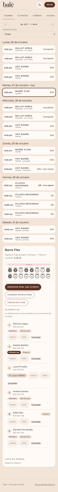
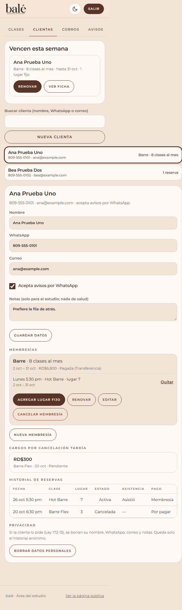
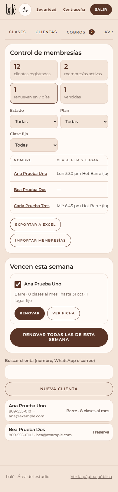
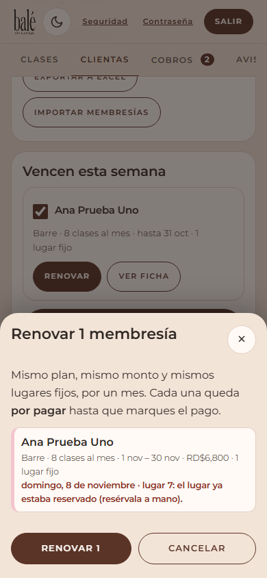
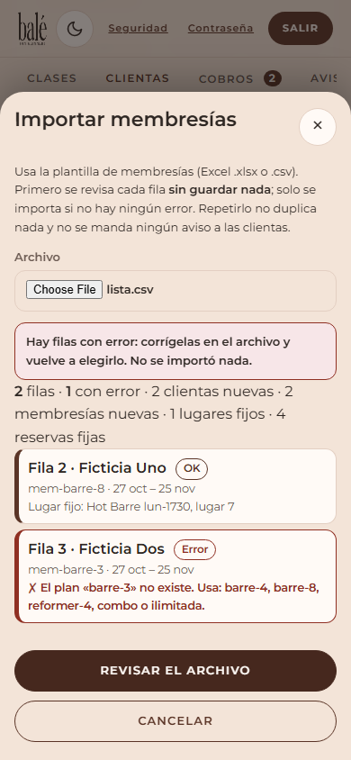
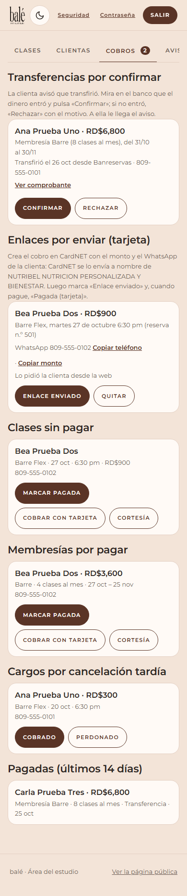
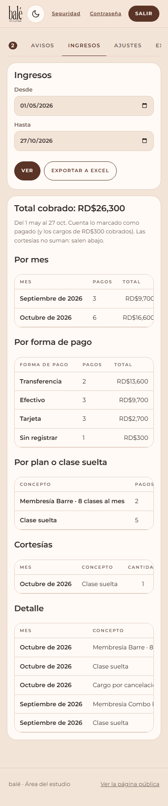
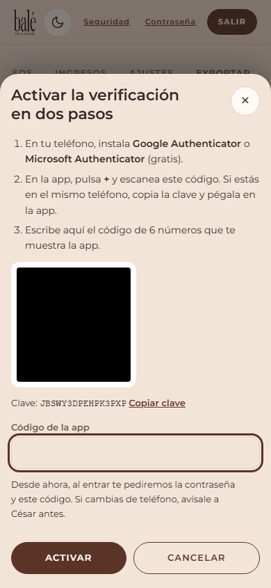
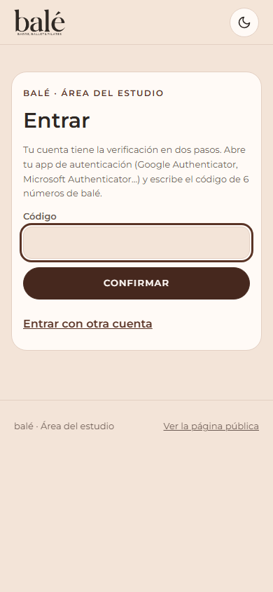

# Área del estudio: guía para Marifer y Brittany

Entra desde el teléfono o la computadora a **https://caesar-valor.github.io/nutribel/bale/estudio.html** (guárdala en favoritos o en la pantalla de inicio). No tiene enlace en la página pública. Entra con tu correo y tu contraseña; si la olvidaste, escribe tu correo y pulsa **¿Olvidaste tu contraseña?**: te llega un enlace para poner una nueva.

Capturas de ejemplo (datos ficticios) en `referencia/capturas-sistema/despues/`.

| Pestaña | Para qué |
|---|---|
| **Clases** | La semana, la lista de alumnas de cada clase, asistencia, reservar, cancelar |
| **Clientas** | **Control de membresías** (el Excel de siempre), renovar las de la semana, fichas, lugares fijos e **importar** |
| **Cobros** | Transferencias por confirmar, pagos con tarjeta, clases y membresías por pagar, cargos de RD$300 y lo pagado |
| **Avisos** | Si los correos y los WhatsApp automáticos están funcionando, y el uso del plan gratis |
| **Ingresos**, **Ajustes** y **Exportar** | Solo tú: el dinero del mes, pago, textos de los avisos, horario, precios, personal, seguridad y Excel |

Lo nuevo de noviembre (control, importar, renovar todas, transferencias, ingresos y verificación en dos pasos) está **al final de esta guía**.

**Si Avisos dice "WhatsApp: desconectado":** los correos siguen saliendo. Lee la frase de debajo: si pide volver a vincular, avísale a César y ten a mano el teléfono del número viejo. Ese teléfono hay que abrirlo al menos una vez cada 14 días, o WhatsApp cierra la sesión.

Tu asistente ve todo menos Ingresos, Ajustes y Exportar (tampoco exporta ni importa el control de membresías). Cada instructora ve solo **Mis clases**: sus alumnas, el lugar, quién viene por primera vez y la asistencia.

## Ver la clase de hoy

**Clases** abre en la semana actual, con la próxima clase elegida. Toca una clase: arriba sale la sala (gris = ocupado) y abajo la lista de alumnas con su lugar. **Miembro** = lugar fijo de una membresía; **Primera vez** = no ha venido antes; **Por pagar** = clase suelta sin pagar. Junto a cada clase: `ocupados/cupo · en espera · por revisar` (por revisar = alguien dijo tener membresía y no aparece registrada).

## Marcar asistencia

Desde **una hora antes** de la clase, toca **Asistió** o **Faltó** en cada alumna. Si te equivocas, toca otra vez el mismo botón y vuelve a quedar sin marcar.

## Reservar por teléfono (o en persona)

En la clase, **Reservar para una clienta** → busca por nombre o WhatsApp (o abre **O una clienta nueva**), elige el lugar en la sala, el pago (**Por pagar**, **Ya pagó** o **Cortesía**) y si le mandas la confirmación. Si la clienta tiene membresía, la base de datos la cuenta sola.

## Cancelar una reserva

En la lista de alumnas, **Cancelar** → elige el cargo: **Automático** (si es el mismo día de la clase, RD$300), **Sí** o **No**, y si la avisas. El lugar queda libre y, si hay lista de espera, se avisa a la primera.

## Asignar el lugar fijo de una miembro (al empezar el mes)

1. **Clientas** → arriba, **Vencen esta semana**: pulsa **Renovar** en cada miembro. Crea la membresía del mes siguiente con el mismo plan **y los mismos lugares fijos**. Pon el pago si ya lo tienes.
2. Miembro nueva: busca su ficha (o **Nueva clienta**) → **Nueva membresía** → plan, fechas, precio y pago → en la membresía, **Agregar lugar fijo** → elige la clase y su lugar en la sala.
3. Si en alguna fecha ese lugar ya estaba reservado por otra persona, te sale la lista para que decidas (cambiar la reserva o reservarle a mano).

El lugar fijo se reserva solo cada semana mientras dure la membresía.

## Cobros

**Cobros** → **Clases sin pagar**: **Marcar pagada** (transferencia, tarjeta o efectivo), **Cobrar con tarjeta** o **Cortesía**. **Cargos por cancelación tardía**: **Cobrado** o **Perdonado**. Todo pide confirmación.

### Pagos con tarjeta (CardNET)

CardNET no tiene un enlace fijo: cada cobro lo creas tú con el monto, y CardNET le escribe a la clienta por WhatsApp. El cobro le llega a nombre de **NUTRIBEL NUTRICION PERSONALIZADA Y BIENESTAR** (la página ya se lo avisa).

1. La clienta pulsa **Pagar con tarjeta** (en la confirmación o en "Ver mi reserva"). Te escribe por WhatsApp con su nombre, la clase, el monto y el número de reserva, y el cobro aparece en **Cobros → Enlaces por enviar**. La pestaña **Cobros** muestra cuántos hay por enviar.
2. En CardNET, crea el cobro: **Copiar monto** y **Copiar teléfono** te ayudan. Luego pulsa **Enlace enviado**.
3. Cuando el pago entre en CardNET, pulsa **Pagada (tarjeta)**: la reserva queda pagada con tarjeta.
4. **Quitar** saca el cobro de la lista sin marcarlo pagado (si se pidió por error o pagó de otra forma).

**Membresías:** en la ficha de la clienta, **Cobrar con tarjeta** en la membresía. Sigue el mismo camino.

## Cancelar una clase

En la clase, **Cancelar clase** → escribe el motivo (sale en el aviso) y deja marcado **Avisar a las alumnas**. Se cancelan todas sus reservas **sin cargo**. Si fue un error, **Reabrir clase** (las reservas no vuelven solas). Para una suplencia de un solo día, **Cambiar instructora**.

## Cuando lleguen los datos del banco

**Ajustes → Pago**: escribe los datos de la transferencia y pulsa **Guardar**. Desde ese momento salen en la confirmación de cada reserva por pagar. (La tarjeta va por cobro: mira "Pagos con tarjeta" arriba.)

---

# Lo nuevo de noviembre (para Marifer y Brittany)

Las capturas son de ejemplo, con datos inventados: `referencia/capturas-sistema/noviembre/`.

## Control de membresías (reemplaza el Excel)

**Clientas**, arriba: los contadores (**clientas registradas**, **membresías activas**, **renuevan en 7 días** y **vencidas**) y una tabla con las mismas columnas del Excel: nombre, clase fija y lugar, correo, teléfono, plan, inicio, último pago, próximo pago, monto, método, banco y estado.

- **Activa:** al día. **Renueva pronto:** termina en los próximos 7 días (lo cambias en Ajustes → Membresías). **Vencida:** ya terminó y no tiene la siguiente.
- Filtra por **estado**, **plan** o **clase fija**. Toca el nombre para abrir su ficha.
- **Exportar a Excel** (solo Marifer): baja la tabla para abrirla en Excel.
- El **último pago** se pone solo cuando marcas una membresía como pagada. Si fue otro día, cámbialo en la ficha → membresía → **Editar** (fecha del pago y banco).

## Renovar todas las de esta semana

En **Vencen esta semana** cada membresía tiene una casilla marcada. **Renovar todas las de esta semana** → primero sale la **revisión**: el periodo nuevo (un mes), el monto (el mismo que pagó) y sus lugares fijos. Si algún lugar ya no se puede, sale en rojo: otra miembro lo tiene, o ese día ya lo reservó alguien (resérvalo a mano o cambia la reserva). Pulsa **Renovar** para guardar. Todas quedan **por pagar** hasta que marques el pago (en Cobros → Membresías por pagar, o cuando la clienta avise la transferencia).

Desmarca la casilla de quien no va a renovar.

## Importar membresías (solo Marifer)

**Clientas → Importar membresías** → elige el Excel (la plantilla `membresias.xlsx`) o un `.csv`. Funciona en el teléfono.

1. **Revisar el archivo:** cada fila sale en verde (bien) o en rojo con el motivo (plan que no existe, WhatsApp mal escrito, lugar ya ocupado…). **Todavía no se guardó nada.**
2. Si hay alguna fila en rojo, corrígela en el Excel, guárdalo y vuelve a elegirlo. Solo se importa cuando **no hay ningún error**.
3. **Importar** → sale el resumen: clientas nuevas, membresías, lugares fijos y reservas fijas.

Repetirlo no duplica nada, y a las clientas no les llega ningún aviso. Si el Excel tiene varias hojas, se lee la que se llama **«Membresías»**. Columnas que se pueden añadir: **Banco** y **Último pago**.

## «Ya transferí»: transferencias por confirmar

Cuando una clienta transfiere, en la confirmación de su reserva o en «Ver mi reserva» pulsa **Ya transferí** y escribe la fecha y el banco (y, si quiere, sube la foto del comprobante). En **Cobros → Transferencias por confirmar** te aparece con el monto, y la pestaña Cobros muestra cuántas hay.

1. Mira en el banco que el dinero entró. Si subió la foto, **Ver comprobante**.
2. **Confirmar** → la reserva o la membresía queda **pagada por transferencia** y a la clienta le llega «Recibimos tu pago».
3. Si no entró: **Rechazar** y escribe el motivo (por ejemplo «No vemos el depósito»). Le llega a ella, y puede avisar de nuevo.

Si la pagó de otra forma (efectivo, tarjeta), márcala pagada como siempre: el aviso de transferencia se quita solo.

## Membresías por pagar y lo pagado

En **Cobros → Membresías por pagar**: **Marcar pagada** (cómo pagó, la fecha y, si fue transferencia, el banco), **Cobrar con tarjeta** (pasa a «Enlaces por enviar», como las clases) o **Cortesía**. Abajo, **Pagadas (últimos 14 días)**: lo que entró.

## Aviso de renovación a la clienta (apagado)

En **Ajustes → Membresías y aviso de renovación**: si lo enciendes, a cada miembro le llega un correo **3 días antes** de que venza (lo puedes cambiar) con el monto y cómo pagar: transferencia (con su enlace para «Ya transferí») o tarjeta. Por WhatsApp también, si el WhatsApp automático está encendido y ella lo aceptó. Sale una sola vez, entre las 9 am y las 8 pm. **Antes de encenderlo**, revisa el texto en Ajustes → Textos de los avisos → **Membresía por vencer**.

## Ingresos (solo Marifer)

Pestaña **Ingresos**: el total cobrado entre dos fechas (por defecto, los últimos 6 meses), **por mes**, **por forma de pago** y **por plan o clase suelta**, con los cargos de RD$300 cobrados. Las **cortesías** salen aparte: no suman. **Exportar a Excel** baja el detalle.

Cuenta lo que está marcado como pagado en el área: si algo se pagó y no se marcó, no sale.

## Verificación en dos pasos (Marifer y Brittany)

Protege la cuenta: además de la contraseña, al entrar se pide un código que cambia cada 30 segundos en tu teléfono.

1. Instala en el teléfono **Google Authenticator** o **Microsoft Authenticator** (gratis).
2. En el área, arriba, **Seguridad** → **Activar verificación en dos pasos**.
3. En la app, **+** → escanea el código QR (si estás en el mismo teléfono, **Copiar clave** y pégala en la app).
4. Escribe el código de 6 números → **Activar**.

Desde ahí, al entrar: contraseña y luego el código. **Si cambias de teléfono, avísale a César antes.**

Cuando las dos la tengan, Marifer puede encender **Ajustes → Seguridad → Exigir la verificación en dos pasos** (solo deja hacerlo si entraste con el código). Mientras esté apagado, es opcional.

 

## Uso del plan gratis

En **Avisos**, Marifer ve cuánto se usa del plan gratis: la base de datos (500 MB), las fotos de comprobantes (1 GB) y los correos del día (unos 500). Si algo pasa del 80 %, sale en rojo: avísale a César.
